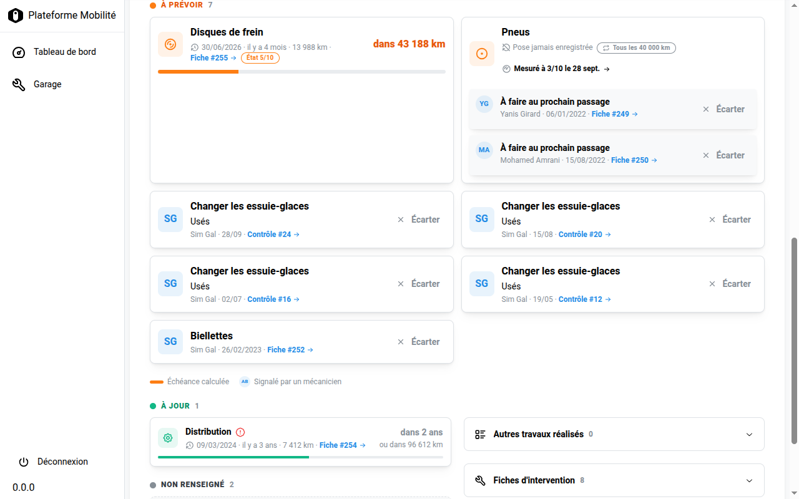
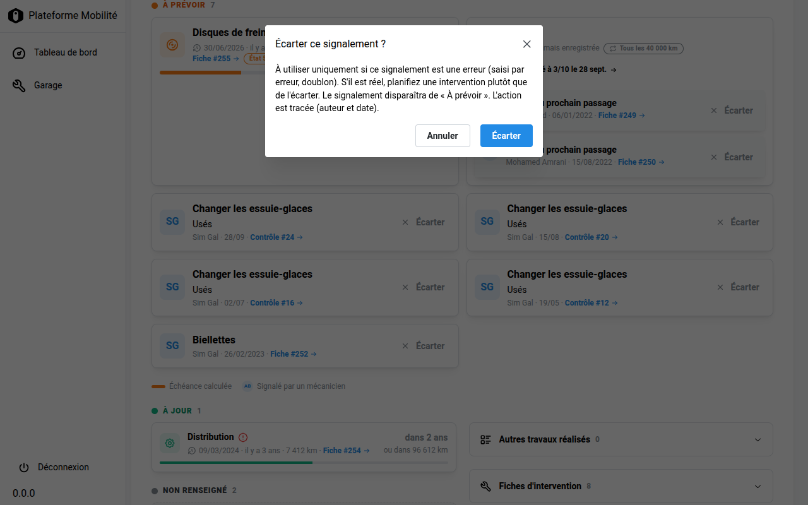
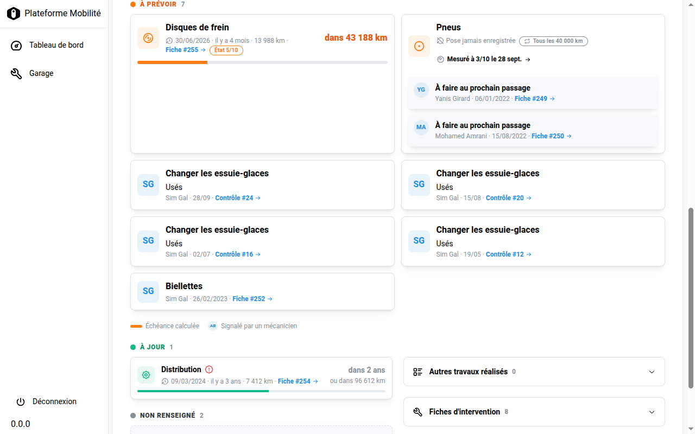

# J'écarte un signalement (erreur de saisie)

**Pour qui ?** Le **responsable garagiste** uniquement (permission `garage.dismiss_signalement`, voir [les permissions](permissions.md)).
**À quoi ça sert ?** Retirer de « À prévoir » un signalement qui **n'aurait pas dû être saisi** : erreur de saisie, doublon.

> ⚠️ **À utiliser uniquement si le signalement est une erreur.** S'il est réel (une vraie usure, un vrai défaut), il ne faut pas l'écarter : il faut **planifier une intervention**. Écarter un signalement réel le fait disparaître du suivi du véhicule.

## 1. Où trouver le bouton

J'ouvre la fiche du véhicule, onglet **Entretien**. Chaque signalement de la zone **À prévoir** porte un bouton **Écarter** à droite : les opérations « À faire au prochain passage » saisies sur une fiche d'intervention, comme les constats issus d'un contrôle (« Changer les essuie-glaces »).

*Onglet Entretien vu par un responsable garagiste : le bouton **Écarter** est présent sur chaque signalement.*

## 2. Je confirme

J'appuie sur **Écarter**. Une fenêtre de confirmation rappelle la règle : « À utiliser uniquement si ce signalement est une erreur (saisi par erreur, doublon). S'il est réel, planifiez une intervention plutôt que de l'écarter. »

- **Annuler** ferme la fenêtre : rien n'est modifié.
- **Écarter** retire le signalement de « À prévoir ».

*La fenêtre de confirmation, avec le rappel de la règle.*

## 3. Ce qui se passe ensuite

- Le signalement disparaît de « À prévoir » et le véhicule est recalculé (compteurs, pastille d'Entretien).
- L'action est **tracée** : l'auteur et la date sont conservés dans l'historique de la fiche.
- L'application ne propose pas d'annuler un écartement : en cas de doute, ne pas écarter.

## Je ne vois pas le bouton

C'est normal si je suis **garagiste** ou **référent** : seul le responsable garagiste peut écarter. Le bouton est alors absent, et l'API refuse la demande (erreur 403).

*Le même écran vu par un garagiste : aucun bouton **Écarter**.*

Un garagiste qui pense qu'un signalement est une erreur le dit à son responsable.
