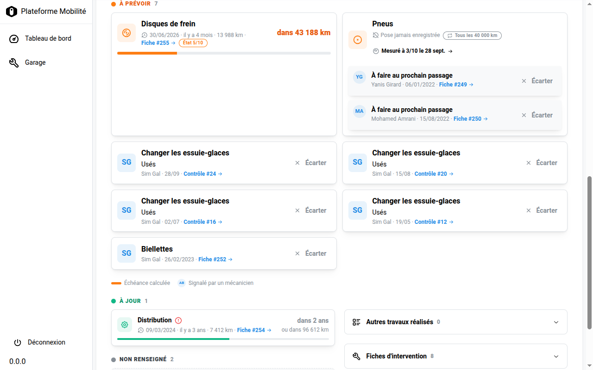
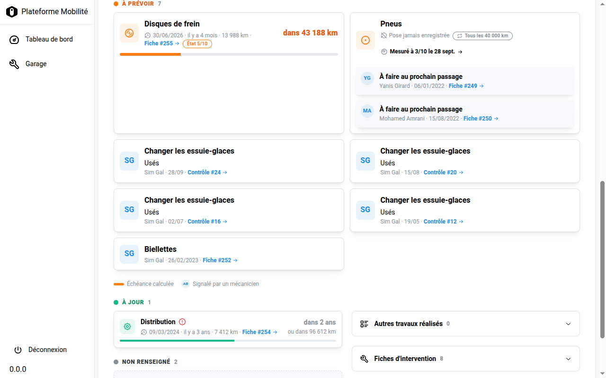

# Les permissions du module Garage

**Pour qui ?** Les administrateurs et l'équipe produit : savoir **qui peut faire quoi** dans le module Garage.
**À tenir à jour :** chaque nouvelle permission s'ajoute ici, avec son effet, les groupes qui l'ont et une capture de ce qui change à l'écran.

## 1. Les groupes

Les permissions s'attribuent par **groupe**. Quatre groupes existent pour le Garage. Ils sont recréés à chaque déploiement par `garage/apps.py` : **ne pas les modifier à la main**, les changements seraient écrasés.

| Groupe | Qui |
|---|---|
| **Garagiste** | Le mécanicien : saisit les interventions et les contrôles. |
| **Responsable garagiste** | Le garagiste responsable : tout ce que fait le garagiste, plus les corrections et les décisions sensibles. |
| **Référents** | L'accompagnant social : consulte l'état des véhicules, ne modifie rien. |
| **Responsable référents** | Le responsable des référents : consulte, et corrige un kilométrage. |

> Ne pas confondre : « Référents » (avec un s, majuscule) est le référent du **module Garage**. Le groupe `referent` (minuscule) est l'ancien groupe d'administration, avec presque tous les droits.

## 2. Qui a quelle permission

| Permission | Garagiste | Responsable garagiste | Référents | Responsable référents |
|---|:-:|:-:|:-:|:-:|
| `view_dashboard` | ✅ | ✅ | ✅ | ✅ |
| `view_vehicle` | ✅ | ✅ | ✅ | ✅ |
| `manage_intervention` | ✅ | ✅ | — | — |
| `manage_inspection` | ✅ | ✅ | — | — |
| `correct_mileage` | — | ✅ | — | ✅ |
| `override_maintenance_block` | — | ✅ | — | ✅ |
| `edit_validated_inspection` | — | ✅ | — | — |
| `dismiss_signalement` | — | ✅ | — | — |

Un **superutilisateur** a toutes les permissions, y compris celles-ci.

## 3. Ce que chaque permission change

| Permission | Effet |
|---|---|
| `garage.view_vehicle` | Voir les véhicules de **toutes ses Actions** (et non de la seule Action courante), et l'onglet **Entretien**, **Contrôles** et **Historique kilométrique** de la fiche véhicule ; l'onglet **Contrôles** d'un contrat. |
| `garage.view_dashboard` | Accéder au tableau de bord du Garage. *(Déclarée et attribuée ; aucun contrôle dans le code à ce jour.)* |
| `garage.manage_intervention` | Créer, modifier et valider une **fiche d'intervention** ; bouton **Continuer l'intervention** sur la fiche véhicule. |
| `garage.manage_inspection` | Créer et modifier une **fiche de contrôle** ; bouton **Nouveau contrôle** et le **+** de la barre du bas sur mobile. |
| `garage.edit_validated_inspection` | Modifier une fiche de contrôle **validée depuis plus de 3 jours**. Avant 3 jours, tout garagiste peut la corriger. |
| `garage.correct_mileage` | **Corriger un kilométrage** erroné dans l'historique (lien « Corriger le kilométrage »). |
| `garage.override_maintenance_block` | Forcer le passage d'un véhicule en **disponible** malgré un blocage maintenance. *(Déclarée et attribuée ; aucun contrôle dans le code à ce jour.)* |
| `garage.dismiss_signalement` | **Écarter un signalement** d'entretien (bouton **Écarter** de l'onglet Entretien), pour une erreur de saisie uniquement. Voir [J'écarte un signalement](garage-ecarter-un-signalement.md). |

## 4. Exemple : le bouton « Écarter »

Le même écran de l'onglet **Entretien**, selon la permission `dismiss_signalement` :

| Responsable garagiste (permission accordée) | Garagiste (permission absente) |
|---|---|
|  |  |
| Le bouton **Écarter** est affiché. | Aucun bouton. |

Le contrôle est **double** : le bouton disparaît à l'écran, et l'API refuse la demande (erreur 403) si on la forme à la main. Ce principe vaut pour toutes les permissions de ce document.

## 5. Ajouter une permission

1. Déclarer la permission dans le `Meta.permissions` d'un modèle `garage/models.py`, puis générer la migration.
2. L'attribuer aux groupes voulus dans `GROUPS_PERMISSIONS` (`garage/apps.py`).
3. La contrôler **côté API** (`has_perm`) **et** côté écran (`isAuthorized` / `CanAccess`).
4. Régénérer les types : `bash generateType.sh`.
5. Ajouter une ligne aux tableaux des sections 2 et 3, avec une capture si l'écran change.
